# WAMM'nin Raporlanan Başarısı Ne Kadar Genellenebilir? Veri Benzerliği, Gizleme ve Araç İzleri Üzerine Bir Analiz

## Özet

WAMM çalışması [1], web saldırılarını sınıflandıran bir XGBoost modeliyle **%99.59 doğruluk** bildirmiştir. Bu sonuç, verinin satır satır rastgele bölünmesiyle elde edilmiştir. Bu çalışmada aynı model yeniden kurulmuş ve üç soru sorulmuştur:

- **A. Benzerlik:** Test kümesindeki isteklerin benzerleri eğitimden çıkarılınca başarı ne olur?
- **B. Gizleme:** Saldırının yazımı değiştirilince (ör. `sleep` → `s""leep`) model yine tanır mı?
- **C. Açıklama:** Model kararını saldırının kendisine mi, yoksa verideki tesadüfi izlere mi dayandırıyor?

**Temel bulgular**

- Veri setlerindeki satırların %45–56'sı birebir tekrardır. Rastgele bölmede test isteklerinin %49–59'unun eğitimde birebir kopyası vardır.
- Benzer istekler eğitimden ayrılınca Macro F1, DS-Base'te 0.976'dan 0.909'a, DS-Augmented-v2'de **0.862'den 0.633'e** düşmektedir.
- Gizlenmiş saldırıların %97'den fazlası hâlâ "saldırı" olarak yakalanmaktadır; ancak bazı sınıflarda saldırının **türü** yanlış belirlenmektedir.
- DS-Augmented-v2'de model, SSRF ve Command Injection sınıflarını kısmen saldırıdan değil, **veri üretim aracının (Burp Suite) alan adından** tanımaktadır.
- Bazı sınıflarda etiketler içerikle uyuşmamaktadır; saldırı içermeyen tek bir istek 1,840 kez ve üç farklı etiketle tekrarlanmaktadır.

**Temel sınırlılık:** Sonuçlar WAMM veri setleriyle sınırlıdır; gerçek dünya trafiğinde doğrulanmamıştır.

---

## 1. Giriş

### 1.1. Problem

Bir saldırı sınıflandırıcısının değeri, **daha önce görmediği** saldırılardaki başarısıdır. Test kümesi eğitim kümesine çok benziyorsa, ölçülen başarı modelin öğrendiğini değil, hatırladığını gösterebilir.

Bu çalışmada iki görev ayrı tutulmuştur:

- **Saldırı tespiti:** İstek normal mi, saldırı mı?
- **Saldırı türü sınıflandırması:** Saldırı hangi tür (SQLi, XSS…)?

### 1.2. WAMM ne yapıyor?

WAMM [1], SR-BH 2020 veri setini temizleyip Burp Suite ile artırmış ve herkese açık veri setleri yayımlamıştır. Bu, alan için değerli bir katkıdır; bu çalışma da ancak bu veriler sayesinde yapılabilmiştir.

| Makale ne diyor? | Bunun önemi |
|---|---|
| Tekrarlar "benign" kayıtlar için temizlendi: *"MinHash and locality-sensitive hashing (LSH) were applied to eliminate any structurally redundant benign entries"* [1, §III-C3] | Saldırı kayıtlarındaki tekrarlar için böyle bir adım yok. |
| Saldırılar Burp Suite ile üretildi: *"synthetic malicious payloads were generated using Burp Suite scans to ensure coverage of the OWASP Top 10 categories"* [1, §III-C3] | Otomatik araçlar birbirine çok benzeyen örnekler ve araca özgü izler bırakır. |
| Veri rastgele bölündü: *"stratified sampling was applied to preserve the attack categories distribution"* [1, §III-D] | Sınıf oranları korunur, ama benzer örnekler eğitim ve teste dağılabilir. |
| Test kümesi "görülmemiş" olarak nitelendirildi: *"The DS-Augmented-v2-Test data served as the unseen portion of the augmented dataset."* [1, §V-D] | Eğitimde kullanılmamış olması, *yeni* olduğu anlamına gelmez. |

### 1.3. Araştırma soruları ve hipotezler

| Eksen | Soru | Hipotez |
|---|---|---|
| A | Rastgele bölmede test örneklerinin eğitimde eşi var mı? | **H1:** Önemli bir kısmının var. |
| A | Benzerler ayrılınca başarı ne olur? | **H2:** Düşer. **H2b:** Yalnızca birebir kopyaları ayırmak yetmez. **H3:** Düşüş artırılmış veride daha büyüktür. |
| B | Gizleme performansı ne kadar etkiler? | **H4:** Recall belirgin düşer. **H5:** Etki sınıflara göre farklıdır. |
| C | Model neye bakıyor? | **H6:** Yanlış sınıflanan gizlenmiş örneklerde modelin dayandığı özellikler bozulmuştur. |

Hipotezler deneylerden önce yazılmıştır. H4'ün sonuçlara göre iki parçaya ayrılması (H4a, H4b; Bölüm 5) sonradan yapılmıştır.

---

## 2. İlgili Çalışmalar

- **Güvenlikte makine öğrenmesi hataları.** Arp ve ark. [3], 30 güvenlik makalesini inceleyerek her birinde en az üç değerlendirme hatası bulmuştur. Bunlardan biri doğrudan bu çalışmanın konusudur:
  > *"Artifacts unrelated to the security problem create shortcut patterns for separating classes. Consequently, the learning model adapts to these artifacts instead of solving the actual task."* [3, §2, P4]
- **Benzer örnekler başarıyı şişirir.** Zararlı yazılım sınıflandırmasında [4]:
  > *"This problem is exacerbated by families of closely related malware, where including even one variant in the training set may allow the algorithm to identify many variants in the testing."* [4, §1]

  Kaynak kodu modellerinde de yakın kopyaların başarı ölçütlerini %100'e kadar şişirebildiği gösterilmiştir [5].
- **Yakın kopya tespiti.** Benzerlik, Broder'in tanımladığı shingle ve Jaccard benzerliğiyle [7], büyük veride ise MinHash ve LSH ile ölçülür [8].
- **Açıklanabilirlik.** SHAP, bir tahmini özellikler arasında paylaştırarak hangi özelliğin ne kadar katkı verdiğini gösterir [6].

Bu çalışma, bu sorunları web saldırısı sınıflandırmasında ve özellikle otomatik araçla artırılmış bir veri setinde birlikte incelemektedir.

---

## 3. Veri ve Yöntem

### 3.1. Veri setleri

WAMM'nin resmi deposundan [2] iki veri seti kullanılmıştır:

| | DS-Base | DS-Augmented-v2 |
|---|---:|---:|
| Satır | 859,293 | 704,665 |
| Sınıf | 12 | 9 |
| En büyük sınıflar | Normal %55, SQLi %29 | Normal %70, SQLi %21 |
| En küçük sınıf | Dictionary Password Attack (1,142) | Code Injection (1,199) |

DS-Base'te istekler tek bir test sitesine gider ve saldırılar genellikle adres satırındadır. DS-Augmented-v2'deki saldırılar ise gerçek sitelere giden uzun isteklerin Cookie, Referer veya User-Agent gibi alanlarına, çoğu zaman çok katlı kodlamayla gömülmüştür.

### 3.2. Model

WAMM'nin XGBoost modeli makaledeki tarife göre kurulmuştur: karakter 1–2 gram TF-IDF (2,000 özellik), 38 elle tasarlanmış özellik ve 8 regex imzası. Makalede verilmeyen hiperparametreler (`n_estimators=300, max_depth=8, learning_rate=0.1`) ve regex ifadeleri tarafımızca seçildiğinden bu bir **yaklaşık yeniden üretimdir**. Kod: `src/features.py`, `src/experiment.py`.

### 3.3. Benzerlik ve bölme

Eğitim ile test arasındaki benzerlik beş kademede engellenmiştir. Her kademede "benzer" sayılan istekler hep aynı tarafa konur:

| Bölme | Ne birlikte tutulur? |
|---|---|
| Rastgele | Hiçbir şey (WAMM'nin yöntemi) |
| Birebir tekrar | Harfi harfine aynı istekler |
| Aynı iskelet | Sayılar, harf büyüklüğü vb. çıkarıldığında aynı olan istekler |
| Yakın-kopya kümesi (0.9 / 0.8) | MinHash/LSH ile bulunan benzer istekler |

**Yakın-kopya kümesi** şöyle oluşturulur: istekler 5 karakterlik parçalara bölünür; parçalarının en az %80'i ortak olan (Jaccard ≥ 0.8) istekler bağlanır; birbirine zincirle bağlanan istekler aynı kümeye girer. Bu zincirleme nedeniyle bir kümedeki iki istek doğrudan %80 benzer olmayabilir (Bölüm 4.5). Kod: `src/families.py`, `src/splits.py`.

Her bölme 3 farklı seed (42, 1, 2) ile tekrarlanmıştır.

### 3.4. Gizleme dönüşümleri

Test saldırılarına, saldırının işlevini koruması **hedeflenen** yazım değişiklikleri uygulanmıştır:

| Dönüşüm | Sınıf | Örnek |
|---|---|---|
| `case` | SQLi, XSS | `UNION SELECT` → `unIOn SeleCt` |
| `whitespace` | hepsi | boşluk → sekme |
| `sql_comment` | SQLi | `UNION ALL` → `UNION/**/ALL` |
| `cmd_quote` | komut enjeksiyonu | `sleep` → `s""leep` |
| `path_dot` | Path Traversal | `../` → `./../` |
| `artifact` | hepsi | `x.oastify.com` → `x.cb-listener.net` |
| `encoding_norm` | hepsi | `%252527` → `%27` (yalnızca hedef çok kez çözüyorsa eşdeğer) |
| `combo` | hepsi | uygulanabilenlerin hepsi birlikte |

Her dönüşümden sonra isteğin geri çözülüp orijinale döndüğü ve parametre adlarının değişmediği otomatik olarak kontrol edilmiştir (yaklaşık 5,700 satırda 0 hata). **Dönüşümlerin gerçek bir uygulamada aynı davranışı ürettiği ise test edilmemiştir.** Kod: `src/obfuscate.py`.

### 3.5. Açıklama yöntemleri

- **SHAP:** Her özelliğin modelin sınıf skoruna katkısı.
- **Karşı-olgusal analiz:** İstekte yalnızca Burp'ün alan adı değiştirilir; model kararını değiştirirse o alan adına bakıyor demektir.
- **Ablasyon:** Model yalnızca basit özelliklerle ve yalnızca TF-IDF ile ayrı ayrı eğitilir.

Ana ölçüt **Macro F1**'dir: her sınıfa eşit ağırlık verdiği için küçük sınıflardaki başarısızlığı gizlemez.

---

## 4. Bulgular

### 4.1. Makalenin sonucu yeniden elde edildi

| | Makale (Acc / Macro F1) | Bu çalışma (Acc / Macro F1) |
|---|---|---|
| DS-Base | 99.01 / 97.05 | 99.16 / 97.67 |
| DS-Augmented-v2 | 99.59 / 86.07 | 99.60 / 86.67 |

Sonuçlar makaleye 0.6 puan içindedir. Makalenin kendi değerlerinde bile DS-Augmented-v2'de accuracy ile Macro F1 arasında yaklaşık 13 puanlık fark vardır: büyük sınıflar iyi, bazı küçük sınıflar zayıf bilinmektedir.

### 4.2. Veri setlerinde yoğun tekrar ve etiket sorunları var

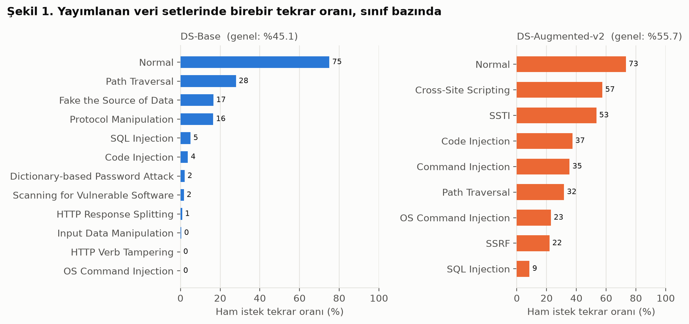

| | DS-Base | DS-Augmented-v2 |
|---|---:|---:|
| Benzersiz istek / toplam | 471,918 / 859,293 | 312,256 / 704,665 |
| Birebir tekrar oranı | %45.1 | %55.7 |
| Normal sınıfında tekrar | %75.0 | %73.2 |

En çarpıcı örnek: DS-Augmented-v2'de **tek bir istek 1,840 kez** geçmekte ve kopyaların 1,072'si XSS, 624'ü SSTI, 144'ü Command Injection olarak etiketlenmiştir (SHA-256: `d56afb0904c5b2f1…`, satırlar 511817, 511818, …). Bu istek sıradan bir Google giriş isteğidir; içinde saldırı göstergesi bulunamamıştır. Tek başına XSS sınıfının %37'sini, SSTI'nin %33'ünü oluşturmaktadır. Aynı girdinin üç farklı etiketi olduğunda hiçbir model bu satırların hepsini doğru bilemez.

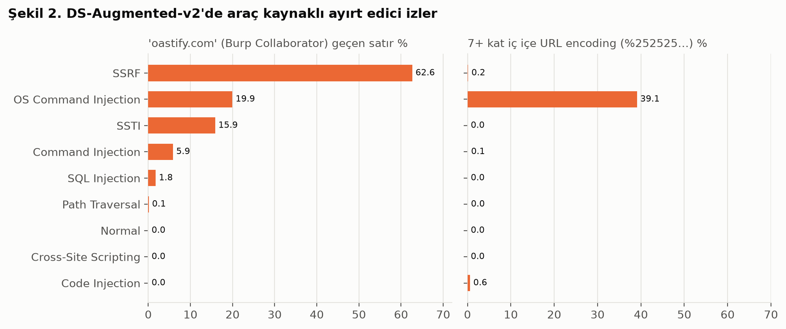

DS-Augmented-v2'de Burp'ün geri çağırma alan adı `oastify.com`, SSRF satırlarının %62.6'sında geçmekte, normal satırlarda hiç geçmemektedir. Gerçek bir saldırgan bu alan adını kullanmak zorunda değildir.

### 4.3. Rastgele bölmede test kümesi "yeni" değil (H1)

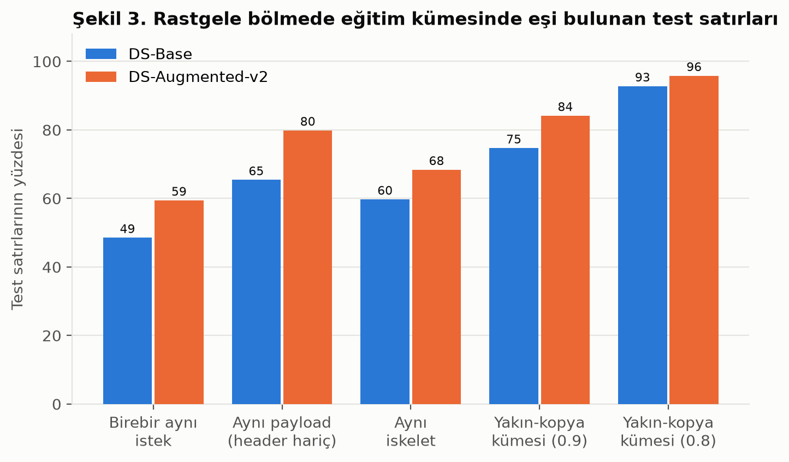

Rastgele bölmede test satırlarının **%49–59'unun eğitimde birebir kopyası**, %93–96'sının aynı yakın-kopya kümesinden bir eşi vardır. **H1 desteklenmektedir.**

### 4.4. Benzerler ayrılınca başarı düşüyor (H2, H2b, H3)

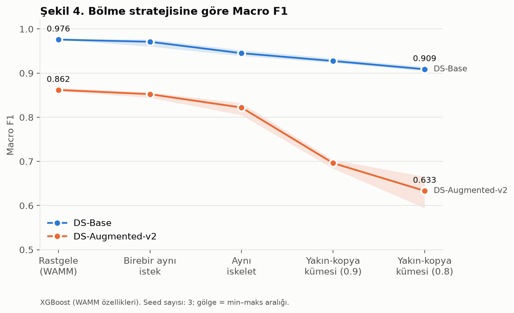

Macro F1, 3 seed ortalaması (köşeli parantez: rastgele bölmeye göre farkın %95 güven aralığı, puan):

| Bölme | DS-Base | DS-Augmented-v2 |
|---|---|---|
| Rastgele | 0.976 | 0.862 |
| Birebir tekrar | 0.971 (−0.5 [−2.8, +1.8]) | 0.852 (−1.0 [−2.3, +0.4]) |
| Aynı iskelet | 0.945 (−3.1 [−4.8, −1.4]) | 0.822 (−4.0 [−7.1, −0.9]) |
| Yakın-kopya 0.9 | 0.928 (−4.9 [−6.1, −3.6]) | 0.696 (−16.6 [−18.9, −14.3]) |
| Yakın-kopya 0.8 | **0.909** (−6.7 [−8.1, −5.4]) | **0.633** (−22.9 [−32.7, −13.0]) |

- Yalnızca birebir kopyaları ayırmak neredeyse hiçbir şeyi değiştirmiyor. **H2b desteklenmektedir.**
- Benzerler ayrılınca belirgin bir düşüş var. **H2 desteklenmektedir.**
- Düşüş artırılmış veride 3–4 kat büyük. **H3 desteklenmektedir.**
- Yalnızca 3 tekrar olduğu için güven aralıkları geniştir.
- Accuracy bu düşüşü göstermez: en zor bölmede bile DS-Augmented-v2'de %97.8'dir.

**Not:** Yakın-kopya bölmesinde test satırlarının %0.01–0.88'inin eğitimde birebir kopyası kalmıştır. Bunların tamamı eğitimde **farklı bir etiketle** bulunan isteklerdir; yani bu bölme küçük de olsa sızıntı içerir.

### 4.5. Yakın-kopya kümeleri beklenenden geniş

300 rastgele kümede üye çiftlerinin gerçek benzerliği ölçülmüştür (`scripts/16_cluster_cohesion.py`):

| | DS-Base | DS-Augmented-v2 |
|---|---:|---:|
| Benzerliği 0.8'in altındaki çiftler | %65 | %68 |
| Benzerliği 0.5'in altındaki çiftler | %26 | %28 |

Zincirleme yüzünden kümeler, birbirine o kadar da benzemeyen istekleri de içermektedir; küme büyüdükçe bu artmaktadır. Bu nedenle 4.4'teki düşüşün bir kısmı, yalnızca yakın kopyaların ayrılmasından değil, test kümesinin daha zor hâle gelmesinden kaynaklanıyor olabilir.

### 4.6. Küçük sınıflar çöküyor

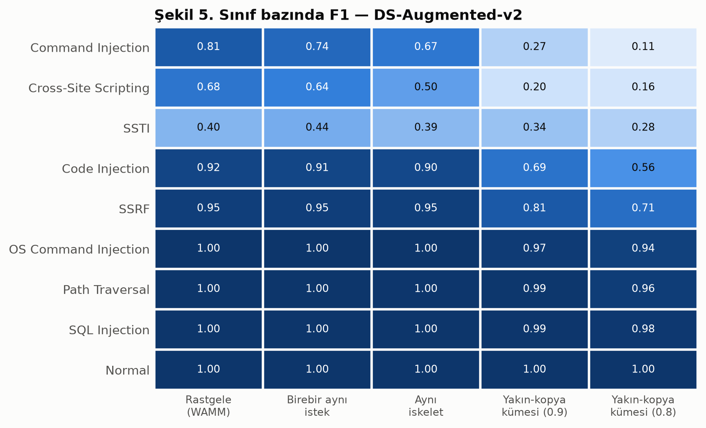

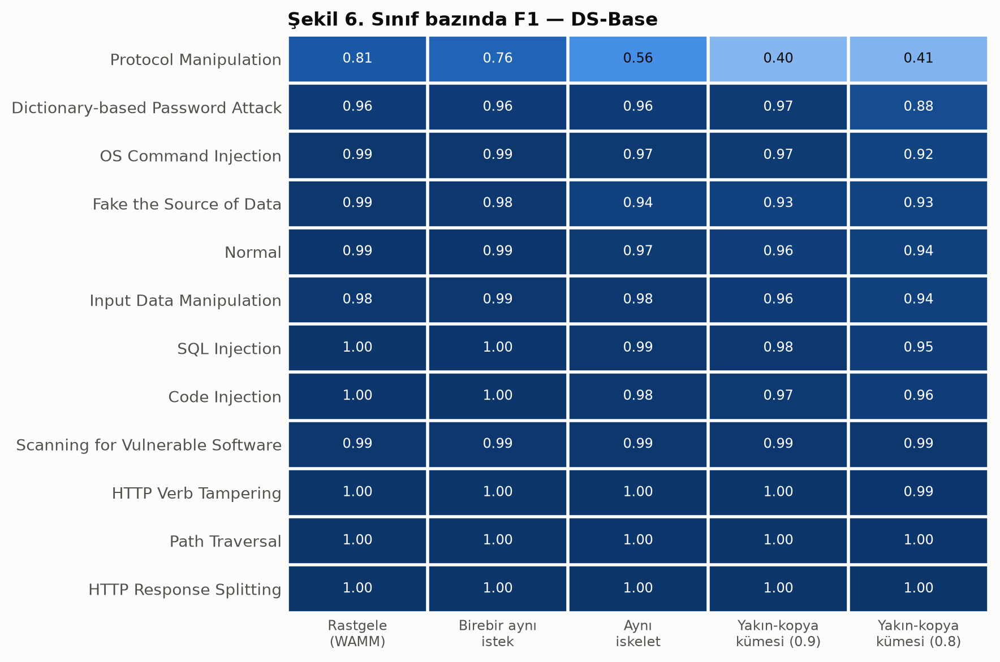

| Sınıf (DS-Aug-v2) | Küme sayısı | F1, rastgele | F1, yakın-kopya 0.8 |
|---|---:|---:|---:|
| Command Injection | 80 | 0.81 | **0.11** |
| Cross-Site Scripting | 70 | 0.68 | **0.17** |
| Code Injection | 120 | 0.92 | 0.56 |
| SSRF | 155 | 0.95 | 0.71 |
| SQL Injection | 15,760 | 1.00 | 0.98 |

Az çeşitli örnekten oluşan sınıflar çökerken, çok çeşitli örneği olan SQL Injection sağlam kalmaktadır.

### 4.7. Yanlış alarm artıyor, hatalar çoğunlukla saldırı türleri arasında

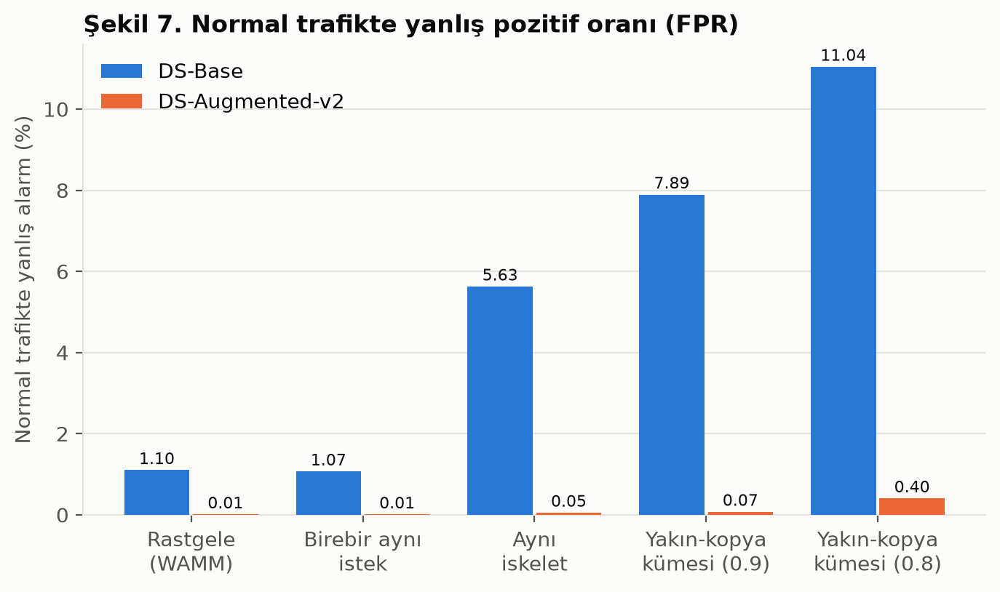

DS-Base'te normal isteklerin saldırı sanılma oranı (FPR), rastgele bölmede %1.1 iken yakın-kopya 0.8 bölmesinde **%11.0**'dır.

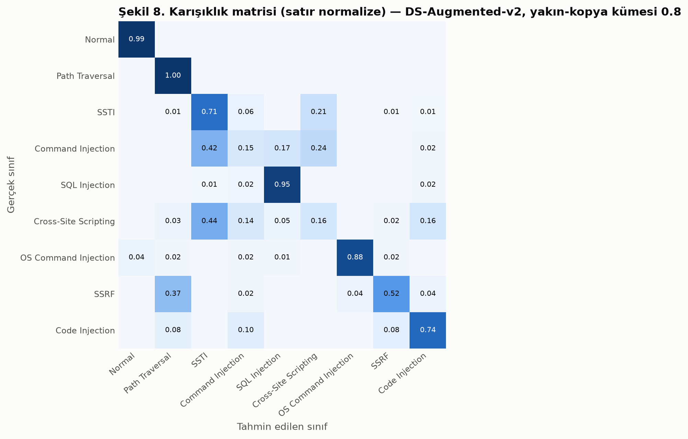

DS-Augmented-v2'de saldırılardaki hataların %90–94'ü başka bir saldırı türüne gitmektedir; "normal" sanılan saldırı azdır. Model saldırıyı yakalayıp **türünü** karıştırmaktadır.

### 4.8. Gizleme: saldırı yakalanıyor, türü karışıyor (H4, H5)

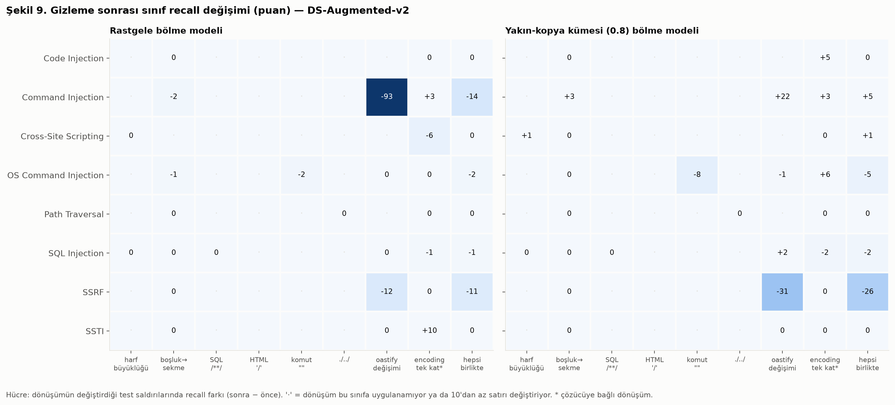

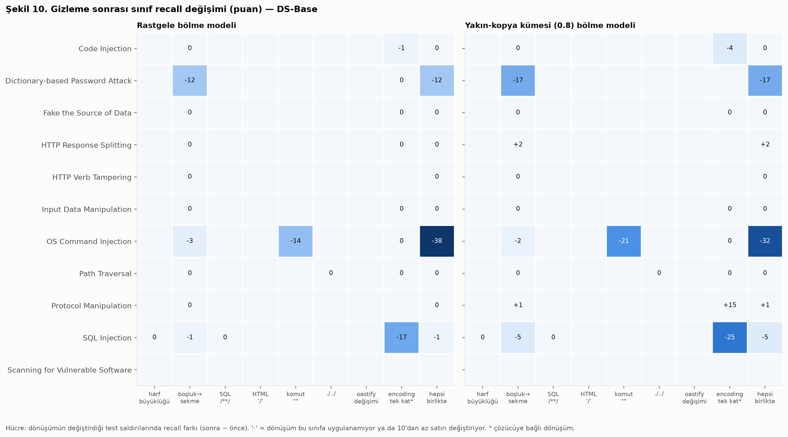

Tüm dönüşümler birlikte (`combo`), seed 42:

| Model | Saldırı türü doğru | Saldırı yakalandı |
|---|---|---|
| DS-Aug-v2, rastgele | %98.7 → %96.8 | %100 → %99.6 |
| DS-Aug-v2, yakın-kopya 0.8 | %86.3 → %82.4 | %98.8 → %97.7 |
| DS-Base, rastgele | %100 → %92.3 | %100 → %99.6 |
| DS-Base, yakın-kopya 0.8 | %99.6 → %91.5 | %100 → %98.2 |

- Saldırı tespiti büyük ölçüde korunmaktadır; asıl etkilenen saldırı türü sınıflandırmasıdır. Bu nedenle H4 **kısmen** desteklenmektedir. Sonradan yapılan ayrıştırmayla: H4a (tür sınıflandırması düşer) ve H4b (tespit daha az etkilenir) desteklenmektedir.
- Etki sınıfa göre çok farklıdır. **H5 desteklenmektedir.** Komut adına iki tırnak eklemek (`s""leep`), DS-Base'te OS Command Injection'ın doğru tanınmasını %100'den **%78–86**'ya indirmektedir. SQL Injection ve Path Traversal ise etkilenmemektedir.

### 4.9. Model SSRF'yi Burp'ün alan adından tanıyor (H6)

Test kümesinde `oastify` geçen bütün saldırı satırlarında **yalnızca alan adı** değiştirilmiştir; saldırının kendisine dokunulmamıştır.

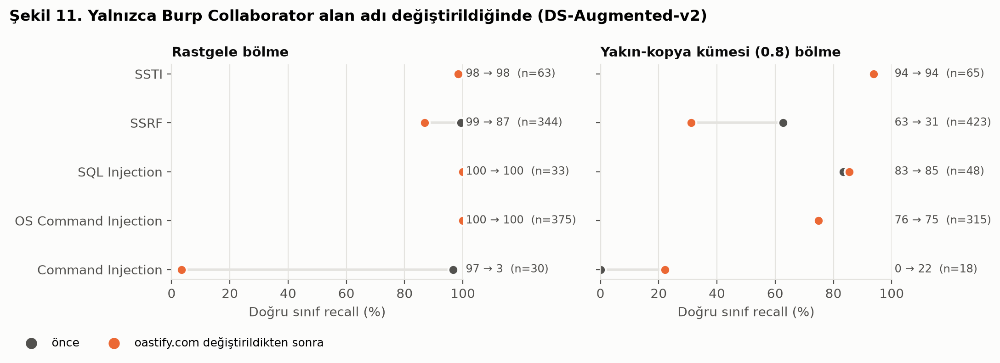

Doğru tanıma oranı, önce → sonra:

| Sınıf | Seed 42 | Seed 1 | Seed 2 |
|---|---|---|---|
| SSRF, rastgele bölme | 99.4 → 86.9 | 99.1 → 93.2 | 99.4 → 87.7 |
| SSRF, yakın-kopya 0.8 | 62.6 → **31.2** | 91.5 → 81.0 | 100 → 87.6 |
| Command Injection, rastgele (30–33 satır) | 96.7 → **3.3** | 97.0 → 6.1 | 96.7 → 3.3 |

Düşüş üç seed'de de görülmektedir. Aynı alan adını içeren SQL Injection ve OS Command Injection satırları ise hiç etkilenmemektedir; yani kısayol bu iki sınıfa özgüdür.

### 4.10. SHAP ve ablasyon: neden böyle?

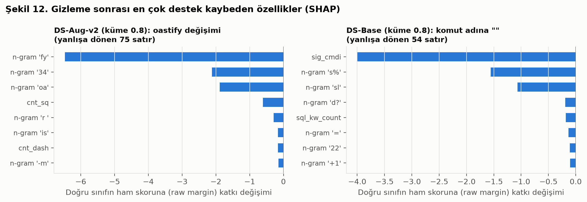

- SSRF için en etkili özelliklerin ikisi, "**oa**stify" kelimesinin karakter ikilileridir (`oa`, `fy`). Alan adı değiştirilince kaybolan destek de tam olarak bu ikililerdir.
- `s""leep` dönüşümünde ise modelin dayandığı komut enjeksiyonu regex imzası (`sig_cmdi`) devre dışı kalmaktadır.
- Model bir sınıfı tek bir ipucuna dayanarak tanıyor; ipucu bozulunca karar da bozuluyor. **H6 desteklenmektedir.**

Ablasyon (Macro F1, seed 42):

| | Yalnızca basit özellikler (46) | Yalnızca TF-IDF | Hepsi |
|---|---:|---:|---:|
| DS-Aug-v2, rastgele | 0.849 | 0.863 | 0.867 |
| DS-Base, rastgele | 0.896 | 0.975 | 0.977 |

DS-Augmented-v2'de istek uzunluğu ve özel karakter sayısı gibi 46 basit özellik bile neredeyse tam başarıya ulaşmaktadır. Artırılmış saldırılar normal trafikten, içeriğine bakmadan da ayrılabilmektedir.

### 4.11. Bazı sınıflar adıyla uyuşmuyor

Her sınıfta, o saldırıya özgü bir göstergenin bulunduğu satır oranı (DS-Augmented-v2):

| Sınıf | Adına uygun içerik | Gerçekte bulunan |
|---|---:|---|
| SQL Injection | %99.8 | — |
| SSRF | %62.6 | çoğunlukla `oastify` |
| SSTI | %17.9 | şablon ifadesi yalnızca %0.7 |
| Command Injection | **%0.8** | %39.5'inde SQL ifadesi (`' or 6619=6619--`) |

"Command Injection" etiketli satırların çoğu aslında SQL yoklamasıdır. Göstergeler kaba olduğu için bu kesin bir etiket hatası değil, ciddi bir belirsizlik işaretidir.

---

## 5. Tartışma

| Hipotez | Sonuç |
|---|---|
| H1, H2, H2b, H3 | Destekleniyor |
| H4 | Kısmen (H4a, H4b sonradan; destekleniyor) |
| H5, H6 | Destekleniyor (tek seed) |

**WAMM'nin başarısı üç parçadan oluşuyor gibi görünmektedir:**

1. **Benzerlikten gelen başarı.** Test örneklerinin benzerleri eğitimde olduğu için elde edilir. Artırılmış veride çok daha büyüktür.
2. **Araç izinden gelen başarı.** Bazı sınıflar saldırıdan değil, Burp'ün bıraktığı izden tanınmaktadır. Bu, Arp ve ark.'nın [3] tanımladığı sahte korelasyon sorununun somut bir örneğidir.
3. **Gerçekten genelleyen kısım.** "Bu bir saldırı mı?" sorusu ve büyük sınıflar (SQLi, Path Traversal) görülmemiş ve gizlenmiş örneklerde de iyi sonuç vermektedir.

**Pratik sonuç:** WAMM "engelle / geçir" kararında görece sağlamdır; ancak saldırı türünü belirleme başarısı rastgele bölmeyle olduğundan yüksek ölçülmüştür.

**Bu sonuçlar neyi kapsıyor?** Burada ölçülen, aynı veri setinin içinde genellemedir. Model farklı sitelerde, farklı zamanlarda ya da gerçek trafikte test edilmemiştir; bu konuda bir sonuç çıkarılmamaktadır.

**Öneriler:** Web saldırısı veri setlerinde (i) yalnızca birebir kopyalar değil benzerler de eğitim ile test arasında ayrılmalı, (ii) accuracy yerine Macro F1 raporlanmalı, (iii) saldırı tespiti ile tür sınıflandırması ayrı ölçülmeli, (iv) artırılmış verilerde araç izleri karşı-olgusal analizle denetlenmelidir.

---

## 6. Sınırlılıklar

- **Yaklaşık yeniden üretim:** Hiperparametreler ve regex ifadeleri tarafımızca seçilmiştir.
- **Tekrar sayısı:** Bölme deneyleri 3, gizleme, SHAP ve ablasyon 1 seed ile yapılmıştır. Command Injection sonucu yalnızca 30–33 satıra dayanmaktadır.
- **Kümeleme:** Kümeler zincirleme içerir (4.5); bölmede küçük bir farklı etiketli sızıntı kalmıştır (4.4).
- **Gizleme:** Dönüşümlerin gerçek uygulamalarda aynı davranışı ürettiği test edilmemiştir.
- **Etiketler:** Sınıf içerik analizi kaba göstergelere dayanır; çelişkili etiketlerin etkisi ayrıca ölçülmemiştir.
- **Kapsam:** Yalnızca WAMM veri setleri ve XGBoost kullanılmıştır; OWASP CRS karşılaştırması yapılmamıştır.

---

## 7. Sonuç

WAMM'nin %99.59'luk başarısının önemli bir kısmı, eğitim ile test arasındaki benzerlikten ve artırılmış veride veri üretim aracının izlerinden gelmektedir. Benzer örnekler ayrıldığında artırılmış veri setinde Macro F1 22.9 puan düşmekte; yalnızca Burp'ün alan adı değiştirildiğinde model SSRF ve Command Injection'ı tanımakta zorlanmaktadır. Buna karşılık saldırı ile normal trafiği ayırma başarısı büyük ölçüde korunmaktadır.

**Gelecek çalışmalar:** site bazlı bölme, çelişkili etiketlerin temizlenmesi, farklı kümeleme yöntemleri, daha fazla tekrar, dönüşümlerin gerçek uygulamada doğrulanması ve OWASP CRS ile karşılaştırma.

---

## Terimler Sözlüğü

| Terim | Anlamı |
|---|---|
| HTTP isteği | Tarayıcının sunucuya gönderdiği mesaj: adres satırı, header'lar ve gövde. |
| Payload | Saldırganın isteğe eklediği kötü amaçlı metin. |
| URL encoding | Özel karakterlerin `%` kodlarıyla yazılması (`%27` = `'`). Çok kez uygulanabilir: `%252527`. |
| WAF | Web uygulamasına gelen saldırıları engelleyen sistem. |
| SQL Injection | Veritabanı sorgusuna SQL eklenmesi (`' OR '1'='1`). |
| XSS | Sayfaya, kullanıcıların tarayıcısında çalışacak kod eklenmesi. |
| Command Injection | Sunucuda işletim sistemi komutu çalıştırma (`; cat /etc/passwd`). |
| Path Traversal | `../` ile izin verilmeyen dosyalara erişme. |
| SSRF | Sunucunun, saldırganın seçtiği bir adrese istek atmasını sağlama. |
| SSTI | Şablon motoruna kod enjeksiyonu (`{{7*7}}`). |
| Burp Suite / Collaborator | Güvenlik test aracı; Collaborator `….oastify.com` adresleri üretir. |
| Eğitim / test kümesi | Modelin öğrendiği veri / başarının ölçüldüğü, eğitimde kullanılmamış veri. |
| Recall | Bir sınıfın örneklerinin ne kadarının doğru bulunduğu. |
| Precision | Modelin o sınıf dediği örneklerin ne kadarının gerçekten o sınıf olduğu. |
| F1 | Precision ve recall'un ortalaması (harmonik). |
| Macro F1 | Bütün sınıfların F1 değerlerinin eşit ağırlıklı ortalaması. |
| Accuracy | Bütün tahminlerin ne kadarının doğru olduğu; büyük sınıflar sonucu belirler. |
| FPR | Normal isteklerin yanlışlıkla saldırı sanılma oranı. |
| Puan | İki yüzde arasındaki fark (%86 → %63 = 23 puan). |
| Seed | Rastgeleliği belirleyen sayı; farklı seed'lerle tekrar, sonucun şansa bağlı olup olmadığını gösterir. |
| Jaccard benzerliği | İki metnin ortak parça sayısının toplam parça sayısına oranı. |
| MinHash / LSH | Milyonlarca metin arasında benzerleri hızlıca bulma yöntemleri. |
| Yakın-kopya kümesi | Birbirine benzerlik zinciriyle bağlanan istekler grubu. |
| TF-IDF karakter n-gram | Metni 1–2 karakterlik parçaların sıklığıyla temsil etme (`oastify` → `oa`, `as`, …). |
| XGBoost | Karar ağaçlarını art arda ekleyerek öğrenen yöntem. |
| SHAP | Bir tahminde her özelliğin katkısını ölçen yöntem. |
| Karşı-olgusal analiz | Girdinin tek bir parçasını değiştirip kararın değişip değişmediğine bakmak. |
| Ablasyon | Modelden bir bileşeni çıkarıp etkisini ölçmek. |
| Kısayol öğrenme | Modelin asıl göreve değil, sınıflarla tesadüfen ilişkili bir ipucuna dayanması. |

---

## Kaynakça

[1] H. Osama et al., "Enhanced Web Payload Classification Using WAMM: An AI-Based Framework for Dataset Refinement and Model Evaluation," *IEEE Access*, 2026, doi: 10.1109/ACCESS.2026.3685450. arXiv: 2512.23610.

[2] CyShield Security R&D, "WAMM Dataset Repository," GitHub. [Online]. Available: https://github.com/CyShield-Security-R-D/WAMM-Dataset-Repository (CC BY 4.0).

[3] D. Arp et al., "Dos and Don'ts of Machine Learning in Computer Security," in *Proc. 31st USENIX Security Symposium*, 2022. arXiv: 2010.09470.

[4] F. Pendlebury, F. Pierazzi, R. Jordaney, J. Kinder, and L. Cavallaro, "TESSERACT: Eliminating Experimental Bias in Malware Classification across Space and Time," in *Proc. 28th USENIX Security Symposium*, 2019. arXiv: 1807.07838.

[5] M. Allamanis, "The Adverse Effects of Code Duplication in Machine Learning Models of Code," in *Proc. ACM SIGPLAN Onward!*, 2019. arXiv: 1812.06469.

[6] S. M. Lundberg and S.-I. Lee, "A Unified Approach to Interpreting Model Predictions," in *Advances in Neural Information Processing Systems (NeurIPS)*, 2017. arXiv: 1705.07874.

[7] A. Z. Broder, "On the Resemblance and Containment of Documents," in *Proc. Compression and Complexity of Sequences (SEQUENCES)*, IEEE, 1997.

[8] J. Leskovec, A. Rajaraman, and J. D. Ullman, "Finding Similar Items: Locality Sensitive Hashing," lecture slides for *Mining of Massive Datasets* (Ch. 3), Stanford University. [Online]. Available: http://www.mmds.org/mmds/v2.1/ch03-lsh.pdf

